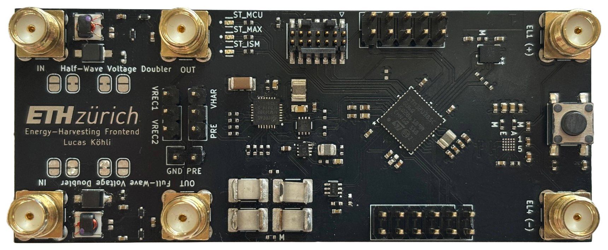
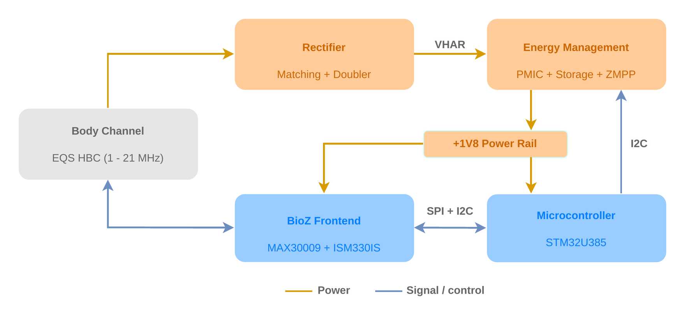
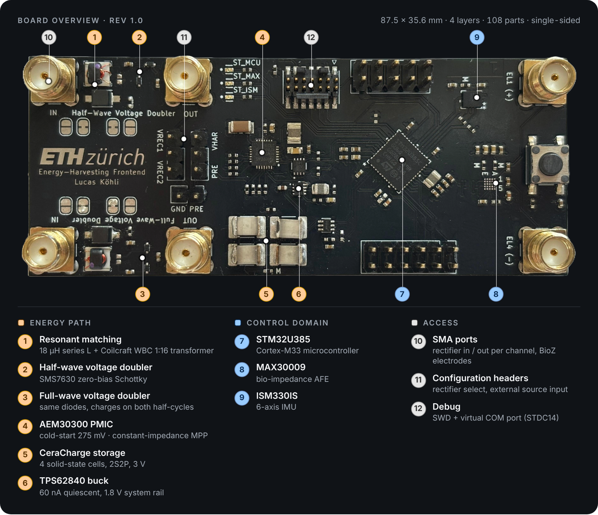
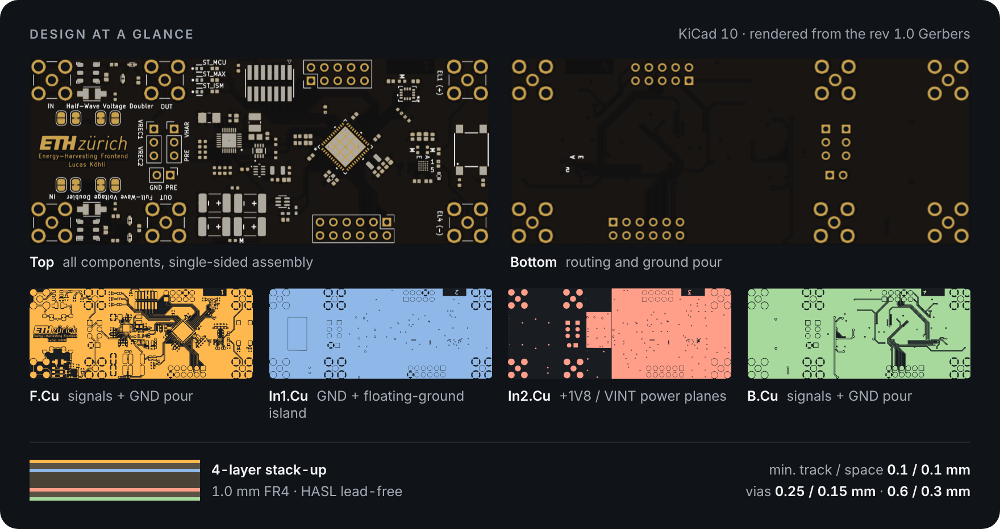
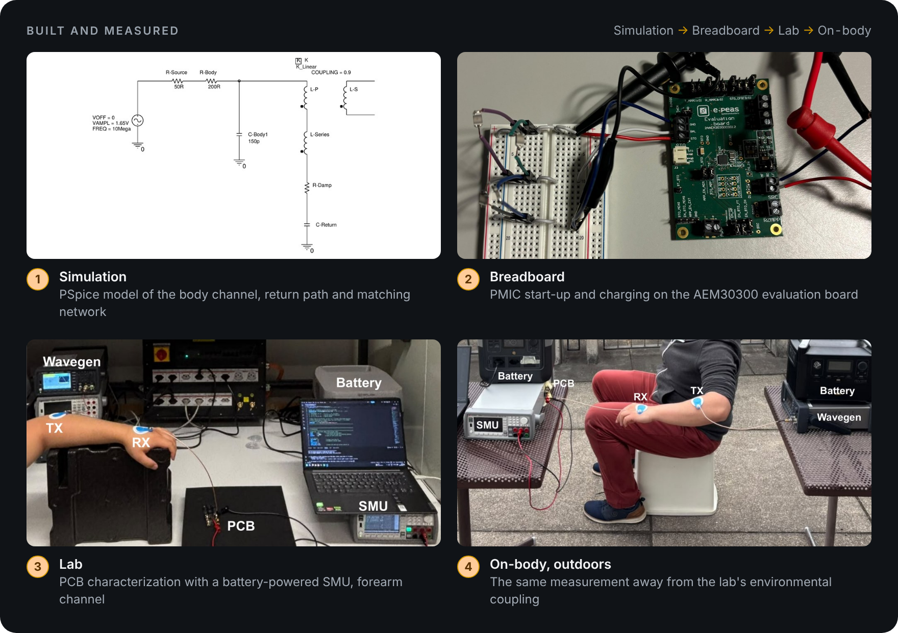
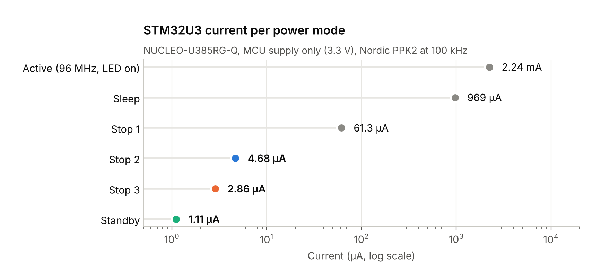

<p align="center">
  
</p>

<h1 align="center">EQS Energy-Harvesting Frontend</h1>

<p align="center">
  <b>Powering body-worn sensors with signals that travel through the human body.</b><br>
  A battery-free harvesting frontend for the electro-quasistatic (EQS) body channel,<br>
  built entirely from off-the-shelf parts and characterized from the bench to the body.
</p>

<table align="center">
  <tr>
    <td align="center"><h3>1–21 MHz</h3>EQS body channel</td>
    <td align="center"><h3>2</h3>rectifier topologies</td>
    <td align="center"><h3>275 mV</h3>PMIC cold-start</td>
    <td align="center"><h3>4 layers</h3>87.5 × 35.6 mm</td>
    <td align="center"><h3>100 %</h3>off-the-shelf parts</td>
  </tr>
</table>

<p align="center">
  <a href="hardware/schematic.pdf"><b>Schematic</b></a> ·
  <a href="https://lkoehli.github.io/eqs-energy-harvesting-frontend/hardware/fabrication/rev1.0/ibom.html"><b>Interactive BOM</b></a> ·
  <a href="docs/design-notes.md"><b>Design notes</b></a> ·
  <a href="docs/measurement-setups/README.md"><b>Measurement setups</b></a> ·
  <a href="docs/errata.md"><b>Errata</b></a>
</p>

---

## From body to battery

<p align="center"></p>

The human body carries EQS signals between wearables with very little loss. This board tests whether the same channel can also **power** them:

- **Harvest:** a series-resonant input and a wideband step-up transformer lift the weak body signal above the rectifier threshold. A zero-bias Schottky voltage doubler converts it to DC.
- **Store:** an AEM30300 PMIC cold-starts from 275 mV and charges solid-state CeraCharge cells. Its operating point is tuned in software through a digital potentiometer.
- **Use:** a 60 nA buck converter supplies a 1.8 V rail for an STM32U385 MCU, a MAX30009 bio-impedance frontend and an IMU.

## Board overview

<p align="center"></p>

The board is a characterization platform, not a minimal design:

- Two rectifier topologies sit side by side under identical conditions.
- Every stage boundary is accessible over SMA.
- Ground references are selectable with solder jumpers.
- Every supply branch has a 0 Ω link for current measurement.

See [board configuration](docs/board-configuration.md) for the details.

## Design at a glance

<p align="center"></p>

Designed in KiCad 10. The [`hardware/`](hardware) folder has the project, the schematic, the Gerbers as fabricated and a BOM generated from the layout.

## Built and measured

<p align="center"></p>

Simulation and the breadboard prototype shaped the design. On the PCB, six setups then add more of the real operating condition, from a direct cable connection to the human body:

| Setup | What it shows |
|---|---|
| [DC-coupled I–V sweep](docs/measurement-setups/01-dc-coupled-iv-sweep.md) | Output I–V / P–V of each doubler vs. amplitude and frequency |
| [Rectifier cold-start threshold](docs/measurement-setups/02-rectifier-coldstart-threshold.md) | Input amplitude at which a doubler meets the PMIC start-up condition |
| [Harvested power vs R_ZMPP](docs/measurement-setups/03-harvested-power-zmpp.md) | Power that actually reaches the storage element |
| [Input impedance](docs/measurement-setups/04-input-impedance-vna.md) | S11 / Z_in vs. frequency and load (VNA) |
| [Floating-ground sweeps](docs/measurement-setups/05-floating-ground-sweeps.md) | Response with a capacitive return path through the environment |
| [On-body](docs/measurement-setups/06-on-body.md) | Forearm and arm-to-leg channels, indoors and outdoors, plus on-body cold-start |

The automated setups run from configuration files with [`hbcbench`](bench-automation/README.md), a small Python package for the SMU and waveform generator.

> **Results in brief:** on the body, the frontend harvests power at the microwatt level and cold-starts unaided from a depleted storage element.
> This work feeds into a publication in preparation (expected early 2027). The detailed measurement data will be added here once the paper is out.

## MCU power-mode measurements

<p align="center"></p>

Alongside the board bring-up, the STM32U385's power modes were measured on a NUCLEO-U385RG-Q with a Nordic Power Profiler Kit II (PPK2, MCU supply only), from 2.24 mA in the active phase (96 MHz, LED on) down to 1.1 µA in Standby. Standby wakes up through a reset that costs about 9× more charge than Stop 3, so it only pays off when the node sleeps longer than about half a second. → [Full analysis and test firmware](mcu-power-modes/README.md)

## Repository

```
├── hardware/           KiCad project, schematic, Gerbers, BOM, interactive BOM (rev 1.0)
├── docs/               design notes, board configuration, measurement setups, errata
├── mcu-power-modes/    STM32U3 power-mode measurements (Nordic PPK2): firmware, analysis, results
└── bench-automation/   Python bench automation (Keysight SMU + waveform generator)
```

## Status

| Stage | State |
|---|---|
| **Rev 1.0** | Fabricated, brought up and characterized on the bench and on the body; two [errata](docs/errata.md) with bodge-wire fixes |
| **Rev 1.1** | Errata corrected in the schematic; layout update pending |
| **Next** | Integration into a wearable, BLE-connected harvesting node (ongoing semester project) |
| **Publication** | In preparation, expected early 2027; detailed results follow here |

## Background

Bachelor's thesis at the [Center for Project-Based Learning (PBL)](https://pbl.ee.ethz.ch), D-ITET, ETH Zürich, spring 2026: *Toward Battery-Free Body-attached Sensor Nodes: Design and Characterization of an EQS Energy-Harvesting Frontend.*

Supervisors: Lukas Schulthess, Dr. Christian Vogt. Professor: Prof. Dr. Luca Benini.

## License

© 2026 ETH Zürich. All rights reserved. An open-source license is to be confirmed with ETH Zürich.
