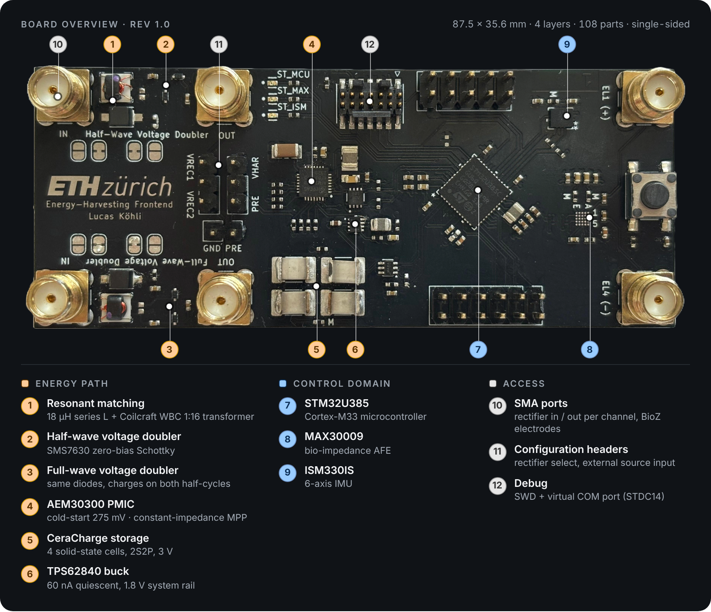

# Board configuration

Every connector, jumper and 0 Ω link on the rev 1.0 board. The tables below were taken from the PCB netlist. Defaults are the as-fabricated states.

## RF / analog ports (SMA)

| Connector | Silkscreen | Signal | Notes |
|---|---|---|---|
| J7 | Half-wave `IN` | T1 primary | Shield → JP3 (GND) or JP5 (floating GND) |
| J11 | Half-wave `OUT` | `VREC1` | Rectifier output, shield on GND |
| J9 | Full-wave `IN` | T2 primary | Shield → JP4 (GND) or JP6 (floating GND) |
| J13 | Full-wave `OUT` | `VREC2` | Rectifier output, shield on GND |
| J14 | `EL1 (+)` | MAX30009 EL1 | Bio-impedance electrode, AC-coupled 47 nF [C26] |
| J15 | `EL4 (−)` | MAX30009 EL4 | Bio-impedance electrode, AC-coupled 47 nF [C27] |

## Source selection (2.54 mm headers)

| Header | Pins | Use |
|---|---|---|
| J10 | `VREC1` – `VHAR` – `VREC2` | Jumper selects which doubler feeds `V_HAR` |
| J6 | `VHAR` – `SRC` – `PRE` | Jumper selects the PMIC input `SRC`: rectifier (`VHAR`) or external source (`PRE`) |
| J16 | `PRE` – `GND` | External DC source input. Evaluates the energy-management stage with a stable source |

Typical settings:

- **Rectifier only, PMIC disconnected:** remove the J6 jumper and probe `VREC1` / `VREC2` at J11 / J13.
- **Rectifier feeding the PMIC:** J10 on the chosen doubler, J6 on `VHAR`–`SRC`.
- **PMIC from a lab supply or SMU:** J6 on `SRC`–`PRE`, source on J16.

## Ground reference (solder jumpers)

Each rectifier channel has two independent ground choices: the reference of the **input SMA shield**, and the reference of the **primary-side DC return** (after the series inductor and 470 Ω damping resistor).

`Float_GND` is a separate copper island on inner layer 1 that has no connection to system GND. It provides the capacitive return path used in the floating-ground and on-body measurements.

| Channel | Function | to GND | to `Float_GND` |
|---|---|---|---|
| Half-wave | Input SMA shield | JP3 (open) | JP5 (bridged) |
| Half-wave | Primary DC return (L4 → R12) | JP1 (open) | JP7 (bridged) |
| Full-wave | Input SMA shield | JP4 (open) | JP6 (bridged) |
| Full-wave | Primary DC return (L5 → R13) | JP2 (open) | JP8 (bridged) |

The board ships in the floating configuration. To tie a channel's primary side to system GND, cut the bridged jumper and close the open one. Never close both of a pair, because that shorts `Float_GND` to GND.

## AEM30300 strap settings

Strap pins are set with 0 Ω links to `VINT` (H) or `GND` (L).

| Pin | Level | Link | Effect |
|---|---|---|---|
| STO_CFG[3:0] | `HLLH` | R3, R4, R5, R6 | Storage protection: V_OVDIS 2.20 V, V_CHRDY 2.50 V, V_OVCH 3.00 V |
| R_MPP[2:0] | `HHH` | tied to `VINT` | Constant-impedance MPP mode: input regulated to the resistance on `ZMPP` |
| EN_HP | L | R7 | Low-power mode |
| EN_STO_CH | H | R8 | See AEM30300 datasheet |
| EN_STO_FT | H | R9 | See AEM30300 datasheet |
| T_MPP[1:0] | `LL` | R10, R11 | See AEM30300 datasheet |

`ZMPP` is set by the MAX5395 digital potentiometer (I²C1, address pin ADDR0 = GND). For fixed-resistor measurements, see [HW-1](errata.md#hw-1) for how to connect R_ZMPP.

## Current-measurement links (0 Ω)

Remove a link and connect an ammeter or SMU across its pads to measure that branch.

| Link | Branch |
|---|---|
| R25 | AEM30300 `STO` → storage `V_STO` (charge current into the cells) |
| R26 | Cell mid-point `Cera_BAL` ↔ AEM30300 `BAL` |
| R23 | TPS62840 output → `+1V8` rail (total control-domain current) |
| R27 | `+1V8` → ISM330IS VDD |
| R28 | `+1V8` → MAX30009 AVDD |
| R29 | `+1V8` → MAX30009 DVDD |
| R22 | TPS62840 VSET → GND (selects 1.8 V; not a measurement link) |

## Debug and I/O

| Ref | Type | Contents |
|---|---|---|
| J1 | Samtec FTSH 2×7, 1.27 mm | SWD (SWDIO, SWCLK, SWO), NRST, USART1 virtual COM port. STDC14 pinout, so it plugs straight into an STLINK-V3MINIE |
| J12 | 2×5, 2.54 mm | Bus breakout: USART1, I²C1 (PMIC side), SPI1 (MAX30009), I²C2 (IMU), GND |
| J8 | 2×6, 2.54 mm | Spare MCU GPIOs (GPIO_0–4, GPIO_8–13), GND |
| SW1 | Push button | MCU reset |
| D5 / D6 / D7 | LEDs | Status `ST_MCU`, `ST_MAX`, `ST_ISM` |

## Storage cells

J2–J5 are the four CeraCharge cells in 2S2P (`V_STO` – `Cera_BAL` – `GND`). For bench characterization, the storage pads can be left unpopulated and driven by an SMU in voltage mode instead (see [measurement setups](measurement-setups/README.md)).
