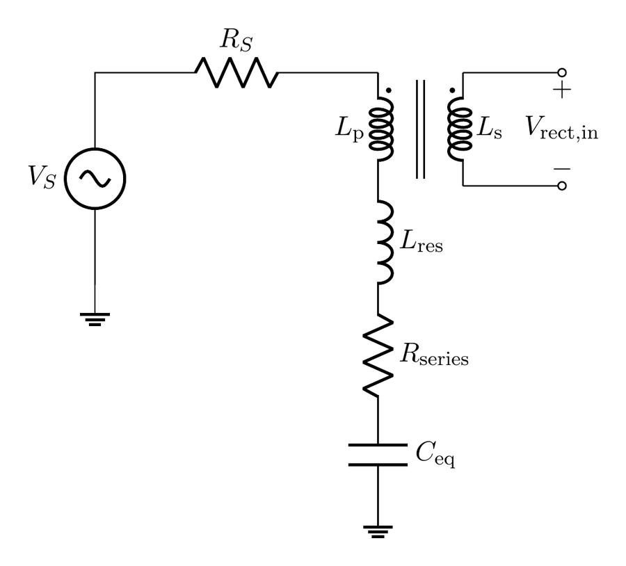
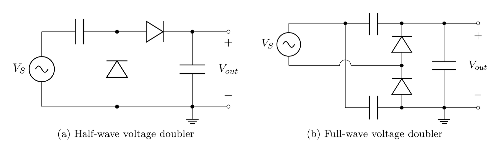
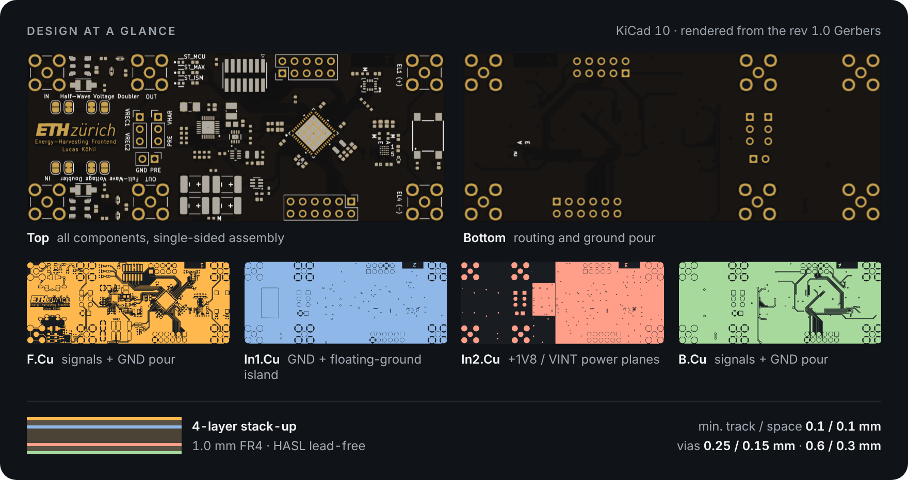

# Design notes

Why the board looks the way it does. Each stage lists the problem it solves, the choice made, and the trade-off accepted. Values refer to the [schematic](../hardware/schematic.pdf); reference designators in brackets.

## Design constraints

The source is the EQS body channel: a weak signal behind a high, mostly capacitive source impedance whose return path closes through the environment (return capacitance C_ret, tens of pF). This sets three requirements:

1. **Extract power from a weak, mismatched source.** The impedance has to be transformed and the reactance compensated.
2. **Cold-start from a fully depleted storage element** using only the harvested signal.
3. **Stay measurable.** The board is a characterization platform, so it should allow the topologies to be compared under identical conditions and give access to every stage boundary.

## 1. Resonant input

Treating the channel as a single equivalent capacitance C_eq (dominated by C_ret), the harvester sees a series RLC once an inductance L is added:

$$Z = R + j\left(\omega L - \frac{1}{\omega C_{eq}}\right), \qquad f_0 = \frac{1}{2\pi\sqrt{L\,C_{eq}}}$$

At f₀ the reactance cancels and the voltage across the reactive elements is magnified by Q. That passive gain is what lifts a sub-threshold body signal above the rectifier and PMIC start-up thresholds. The price is bandwidth (BW = f₀/Q), and C_eq is not constant: posture, movement and nearby conductors detune the tank.

- **Choice:** 18 µH series inductor [L4, L5: Murata LQH32NH180J23L] with f₀ = 10 MHz (upper part of the 1–21 MHz EQS band, where the return-path impedance is lower). Together with the ~5 µH transformer primary this tunes the tank to C_eq ≈ 11 pF.
- **Why the low-capacitance end:** low C_eq is where the channel is weakest and the cold-start margin smallest, so the resonant gain is spent where it is needed. At higher C_eq the channel impedance is lower and less boost is required.
- **Damping:** 470 Ω in series with the primary return [R12, R13] limits Q, which buys tolerance to channel variability.

## 2. Wideband transformer

Even at resonance, the low channel resistance R_S faces the high input impedance of a rectifier operating below its threshold. A transformer scales impedance by n² and voltage by n, so a step-up ratio matches both quantities at the same time:

$$n^2 = \frac{R_S}{R_{rect}} < 1 \quad (N_s > N_p)$$

- **Choice:** Coilcraft WBC Mini wideband RF transformers [T1, T2], broadband over 1–21 MHz. Two ratios were considered:
  - **WBC8-1L (1:8):** its ~22 µH primary could form the whole tank on its own.
  - **WBC16-1TL (1:16, populated):** its ~5 µH primary is combined with the discrete 18 µH inductor.
- **Coupled decision:** the primary winding is part of the resonant tank, so picking the transformer and the series inductance is one decision, not two.
- **Custom winding:** the same footprint takes a custom-wound transformer, so the turns ratio and primary inductance can target the tank and match conditions directly.
- **Limits:** insertion loss, finite coupling, winding capacitance and core loss all grow with the step-up ratio.

## 3. Rectifier: two voltage doublers on one board

Both channels use the same matching network and the same diodes. This lets the topologies be compared directly.

| | Half-wave doubler (Greinacher) | Full-wave doubler (Delon) |
|---|---|---|
| Input / output SMA | J7 / J11 (`VREC1`) | J9 / J13 (`VREC2`) |
| Capacitors | 1 nF series [C31], 4.7 nF output [C32] | 2 × 1 nF stacked [C34, C35], 4.7 nF output [C36] |
| Diodes | D1, D2 | D3, D4 |
| Charge transfer | once per period | on both half-cycles: half the ripple, more continuous load on the source |

**Diode: Skyworks SMS7630 zero-bias Schottky** (SC-79 package)

- Forward voltage of 60–120 mV at ~100 µA.
- Junction capacitance of 0.3 pF.
- The accepted cost is a high saturation current (I_S ≈ 5 µA), which means more reverse leakage.

At 1–21 MHz the junction capacitance is the critical parameter: it opens a displacement-current path that bypasses the junction, and that path grows with frequency.

## 4. Energy management and storage

**PMIC: e-peas AEM30300** [U6]

- Cold-starts from 275 mV / 3 µW and keeps running down to 100 mV.
- Quiescent current in the nA range.
- Switches between boost, buck-boost and buck automatically.
- Configured entirely through strap resistors (see [board configuration](board-configuration.md#aem30300-strap-settings)).

**Constant-impedance MPP (ZMPP)** instead of fractional open-circuit tracking. Open-circuit sampling periodically disconnects the source, which hurts most during cold-start. ZMPP extracts continuously, at the cost of setting the impedance externally.

**Software-set MPP impedance:** MAX5395 [U4], a 256-tap, 10 kΩ digital potentiometer on I²C, lets the MCU sweep R_ZMPP without rework. On rev 1.0 its reference terminal is wired to the wrong node: see [HW-1](errata.md#hw-1).

**Storage: four TDK CeraCharge BCT1812M101AG** (1.5 V, 100 µAh each) [J2–J5] in 2S2P, giving 3 V and 200 µAh.

- They are solid-state, so self-discharge is low enough to accumulate a trickle charge over long unpowered periods.
- There is no liquid electrolyte that would need bulky packaging.
- AEM protection thresholds: V_OVDIS = 2.20 V, V_CHRDY = 2.50 V, V_OVCH = 3.00 V. Charging stops below the cells' rated maximum.

**System rail: TI TPS62840 buck** [U2] with 60 nA quiescent current, set to 1.8 V by a 0 Ω on VSET [R22].

- Its enable input is driven by the AEM30300 `ST_STO` status output.
- The 2.2 V over-discharge threshold keeps the input above the rail across the whole storage window.
- On rev 1.0 the feedback pin is mis-wired: see [HW-2](errata.md#hw-2).

**Storage-voltage monitor:** the AEM30300 exposes no voltage monitor, so the MCU reads V_STO through a 100 k / 100 k divider [R24, R30] into `VSTO_SENS`. A SiP32431 load switch [U7, `DIV_EN`] gates the divider, so it only draws current while a measurement is taken. This lets the firmware shut down in a controlled way before the storage is depleted.

## 5. Control and sensing domain

The whole domain runs from the single 1.8 V rail, so every part is chosen for low-voltage, low-power operation.

| Part | Role | Why |
|---|---|---|
| STM32U385 [U1] | MCU, Arm Cortex-M33 | Stop 3 mode at ~1.6 µA with 8 kB SRAM retained, ~9.5 µA/MHz in Run with SMPS. SPI and I²C stay autonomous in Stop modes, so sensors can wake the core through an interrupt. |
| MAX30009 [U3] | Bio-impedance AFE | Integrated sine current source plus two 20-bit I/Q ADCs. Used in bipolar (2-electrode) mode. The stimulus stays below 500 kHz, well under the harvesting band. Electrodes on SMA J14/J15, AC-coupled with 47 nF. |
| ISM330IS [U5] | 6-axis IMU | On-sensor processing unit (ISPU), low-power modes. |

The MCU's power modes were measured separately on an evaluation board; see [STM32U3 power-mode measurements](../mcu-power-modes/README.md).

The buses are SPI1 to the MAX30009, I²C2 to the ISM330IS, and I²C1 to the MAX5395. Each sensor has its own interrupt line.

## 6. Layout choices for measurability

- **SMA access:** SMA connectors at both rectifier inputs and outputs, so each stage can be driven by lab equipment or probed independently of the rest of the system.
- **Source selection:** headers choose which doubler feeds the PMIC, or bypass both with an external DC source (`PRE`).
- **Ground reference:** solder jumpers select between system GND and a separate **floating-ground** copper island on In1, both for the input SMA shield and for the primary-side DC return.
- **Branch currents:** 0 Ω links in every supply branch (storage, 1.8 V rail, each sensor), so currents can be measured by swapping a link for an ammeter.
- **Stack-up (4 layers, 1.0 mm):** In1 is a solid GND plane plus the floating-ground island. In2 carries the +1V8 and VINT pours and leaves the rectifier section free of power copper.

## References

- Coilcraft, *WBC Mini wideband RF transformers*, datasheet.
- Skyworks, *SMS7630 series surface-mount mixer and detector Schottky diodes*, datasheet.
- e-peas, *AEM30300 buck-boost ambient energy manager*, datasheet.
- TDK, *CeraCharge BCT1812M101AG*, datasheet.
- Analog Devices, *MAX5395*, *MAX30009*, datasheets. Texas Instruments, *TPS62840*, datasheet. STMicroelectronics, *STM32U385*, *ISM330IS*, datasheets.
- A. Datta, L. Ding, S. Sen, "Step-to-Charge: mW-scale power transfer to on-body devices for long channel (>1 m) with EQS resonant human body powering," 2024. [arXiv:2408.01927](https://arxiv.org/abs/2408.01927)
- S. Maity, M. Nath, G. Bhattacharya, B. Chatterjee, S. Sen, "On the safety of human body communication," *IEEE TBME*, vol. 67, no. 12, 2020.
