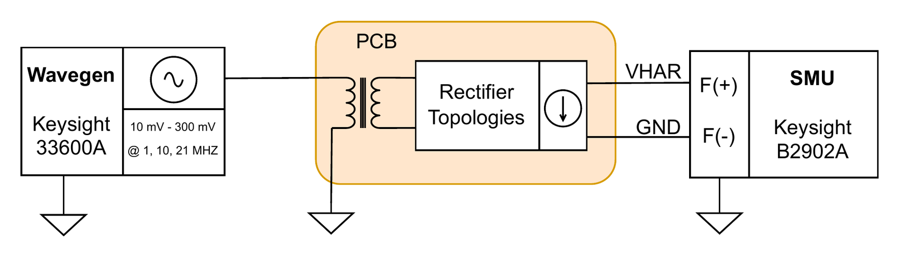

# 1 · DC-coupled I–V sweep

**Purpose.** Characterizes each voltage-doubler topology in isolation: its output I–V and P–V curves as a function of input amplitude and frequency, without any environmental coupling. This is the baseline for every later setup.

## Setup

<p align="center"></p>

| Parameter | Value |
|---|---|
| Input | Sine, 10 → 300 mVpp in 10 mV steps |
| Frequencies | 1 MHz, 10 MHz, 21 MHz (one full sweep each) |
| SMU mode | Force current, sense voltage, 3 V range |
| Inner sweep | 0 A → I_SC (sinking), 70 points by default, adjusted per amplitude so the sweep just passes V = 0 |
| Settling / averaging | 0.3 s per current step, 21 samples averaged |
| Board | J6 open (PMIC disconnected); SMU on `VREC1` (J11) or `VREC2` (J13) |

## Procedure

1. Configure the generator: sine, 0 V offset, output load setting 50 Ω, amplitude unit Vpp.
2. Connect the SMU force terminals to the output under test, with `F+` on `VREC` and `F−` on board GND. Use 4-wire sensing on the same nodes if available.
3. For each amplitude, set the generator, wait for the output to settle, then sweep the SMU current from 0 towards I_SC while recording V and I.
4. Extract V_OC, I_SC, P_MPP, V_MPP and R_opt per amplitude (see [conventions](README.md#conventions)).
5. Repeat for each frequency and for the other topology.

## Notes

- The generator, the board and the SMU share ground, and the board is earthed through the SMU `F−` terminal. This is what makes the measurement *DC-coupled*. Do not use this setup to draw conclusions about the floating operating condition.
- At low amplitudes I_SC is small, so a fixed current range wastes most of the sweep in the negative-voltage region. Give `current_stop_a` as a list with one end point per amplitude so every sweep just passes V = 0.

## Run it

```bash
hbcbench run bench-automation/configs/dc-iv-amplitude-sweep.toml
```
