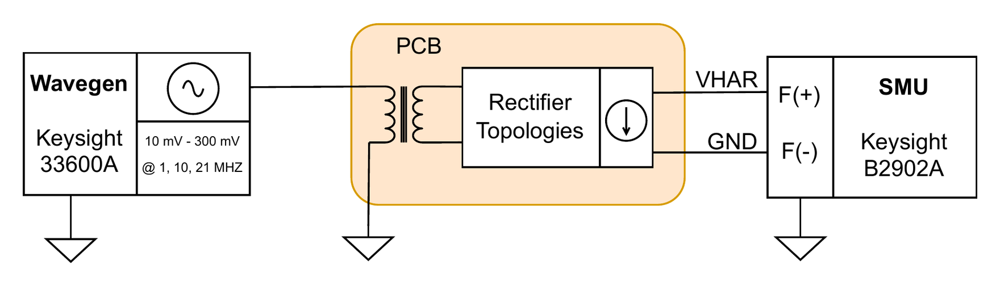

# 2 · Rectifier cold-start threshold

**Purpose.** Before any energy can be harvested, the AEM30300 has to cold-start. According to its datasheet, the source must deliver **3 µW at 275 mV**. This setup finds the minimum generator amplitude at which a doubler meets that condition. It defines the lower operating bound of the frontend, independent of how efficient the topology is above it.

## Setup

Same wiring as [setup 1](01-dc-coupled-iv-sweep.md). Only the SMU mode changes: instead of sweeping current, it holds the rectifier output at 275 mV, emulating the PMIC input at its cold-start voltage.

<p align="center"></p>

| Parameter | Value |
|---|---|
| SMU mode | Force 275 mV, measure current, 1 mA range |
| Input | Sine at a fixed frequency (1, 10 or 21 MHz), amplitude stepped upwards in 1 mV steps around the expected threshold |
| Settling / averaging | 1 s after each amplitude change, 51 samples averaged (sub-µA resolution) |
| Criterion | P = 275 mV · I_harv ≥ 3 µW |

## Procedure

1. Connect as in setup 1, with J6 open so the PMIC is disconnected.
2. Set the SMU to force 275 mV and measure current.
3. Step the generator amplitude and record V, I and P at each step.
4. The threshold is the amplitude where P crosses 3 µW, linearly interpolated between the bracketing steps.

## Notes

- The voltage is held at exactly the PMIC cold-start voltage, so this measures the power available *at that operating point*, not the doubler's maximum power.
- This is a necessary condition only: the rectifier can deliver the power while the full chain still fails to start. [Setup 3](03-harvested-power-zmpp.md) and the [on-body cold-start](06-on-body.md#on-body-cold-start) test the complete system.

## Run it

```bash
hbcbench run bench-automation/configs/rectifier-coldstart-threshold.toml
```
