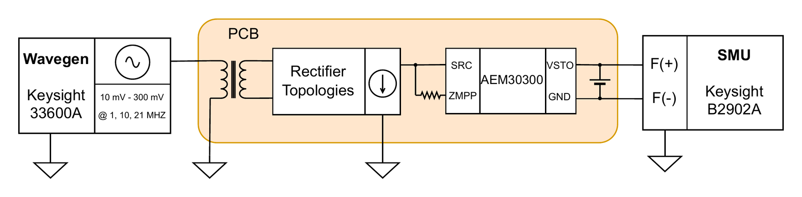

# 3 · Harvested power vs R_ZMPP

**Purpose.** Setups 1 and 2 look at the rectifier output. This one includes the AEM30300 and measures the power that actually reaches the storage element. It also shows how the configured MPP resistance R_ZMPP affects that power.

## Setup

<p align="center"></p>

| Parameter | Value |
|---|---|
| Board | J10 on the doubler under test, J6 on `VHAR`–`SRC`. CeraCharge cells **not** fitted |
| R_ZMPP | Discrete resistor between `ZMPP` and `SRC`, changed between runs (see [HW-1](../errata.md#hw-1)) |
| SMU mode | Force 2.6 V on `V_STO` (emulates a partly charged storage element above V_CHRDY), measure current into the pads |
| Input | Sine, 10 MHz, 10 → 300 mVpp in 10 mV steps |
| SMU ranges | Pre-charge on the 10 mA range, then measure on the 100 µA range |
| Settling / averaging | 5 s after each amplitude change; NPLC 10, 15 samples averaged |

## Procedure

1. Leave the storage cells unpopulated so they are not damaged and the operating point is defined by the SMU.
2. **Pre-charge.** Set the SMU to 2.6 V on a high current range (10 mA) for a few seconds. On the 100 µA range alone, the SMU cannot charge the 100 µF STO capacitor [C15] to the set-point.
3. **Measure.** Switch to the 100 µA range. For each amplitude, wait for the PMIC to settle, then average the current flowing into the storage pads.
4. Delivered power is P = 2.6 V · I_harv. Repeat for each R_ZMPP value.

## Notes

- The two-phase range switch is essential. Without it, `V_STO` stays below the set-point and the measurement is meaningless.
- AEM30300 start-up is a one-shot event: once running, the chip keeps running at lower amplitudes. Sweep upwards only if the start-up threshold matters.

## Run it

```bash
hbcbench run bench-automation/configs/storage-power-zmpp.toml
```
