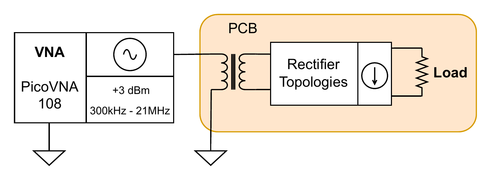

# 4 · Input impedance (VNA)

**Purpose.** Measures the input impedance each doubler presents to the source, and how it changes with the rectifier load. This shows how well the frontend can be matched to the preceding network and how the available signal divides between the source and the rectifier input.

## Setup

| Parameter | Value |
|---|---|
| Measurement | One-port S11 → Z_in |
| Frequency span | 300 kHz – 21 MHz |
| Stimulus power | +3 dBm |
| Loads | Several resistor values across the rectifier output, plus open circuit |
| Board | J6 open; the load sits directly on J11 / J13 |

## Procedure

1. Calibrate port 1 (short / open / load) at the end of the cable that connects to the board, so the reference plane is the board's input SMA.
2. Connect the doubler input; terminate its output with the first load.
3. Record S11 over the span and convert to impedance, Z_in = Z₀ · (1 + S11) / (1 − S11).
4. Repeat for each load and for the open circuit, then for the other topology.

## Notes

- A diode rectifier is non-linear, so its input impedance depends on the drive level. The +3 dBm stimulus fixes that level; compare results only at the same power.
- The load sets the rectifier's operating point and therefore its input impedance. That dependence is what this measurement is meant to show.
