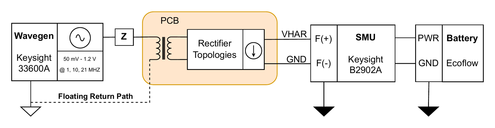

# 5 · Floating-ground sweeps

**Purpose.** The DC-coupled setups give the circuit a galvanic return path it will never have on the body. Here that path is broken. The primary side can only couple back to the generator capacitively, through the environment, which physically reproduces the return capacitance of the EQS channel. Three measurements use this setup: an amplitude sweep, a high-resolution frequency sweep, and a repeatability series.

## Setup

<p align="center"></p>

The SMU and the laptop that controls it run from batteries, so the secondary side has no connection to mains earth. The generator stays on its own supply and is operated from its front panel. A USB connection to the laptop would bond the two grounds and recreate the DC path.

## Measurements

| | Amplitude sweep | Frequency sweep | Repeatability |
|---|---|---|---|
| Amplitude | 50 mVpp → 1.2 Vpp, 50 mV steps | 1.2 Vpp fixed | 1.2 Vpp fixed |
| Frequency | 1, 10, 21 MHz | 1 → 21 MHz, 0.5 MHz steps | 1 → 21 MHz, 1 MHz steps |
| Forward path Z | Full model | Full model | 0 Ω, 1 kΩ, and full model |
| Repeated | – | once | on different days |
| SMU | I–V sweep per point, as in [setup 1](01-dc-coupled-iv-sweep.md) | same | same |

## Procedure

1. Set the solder jumpers so the channel under test uses the floating ground (default, see [board configuration](../board-configuration.md#ground-reference-solder-jumpers)).
2. Insert the forward-path model between the generator output and the board input SMA.
3. Power the SMU from the battery station and run the laptop on battery. Disconnect the generator's USB.
4. For each operating point, set the generator by hand, confirm, and let the script run the I–V sweep. All points go into one file with the amplitude or frequency as a column.

## Notes

- **The response depends on the setup geometry.** In the floating configuration, cable routing, the spacing of the SMA shields and nearby conductors become part of the circuit. For the repeatability series the shield spacing was held constant, to separate environmental effects from how the setup was built.
- **Why this setup matters.** It separates what the frontend does from what the environment does, which is needed to interpret the on-body results.

## Run it

```bash
hbcbench run bench-automation/configs/floating-amplitude-sweep.toml
hbcbench run bench-automation/configs/floating-frequency-sweep.toml
```

Both configurations use a *manual* generator: the script prompts for each setting and waits for confirmation.
