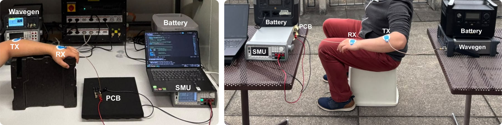
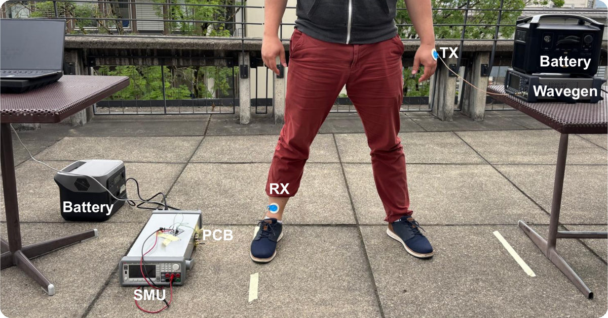

# 6 · On-body measurements

**Purpose.** These setups replace the forward-path model with the actual human body, which is the intended operating condition. Signals couple into and out of the body through electrodes. In the floating configuration, the return path closes through the environment, so nearby conductors become part of the measurement. The same measurements were therefore repeated **outdoors**, away from large conductive structures, to separate the body channel from environmental coupling.

The SMU side is identical to the [floating-ground setup](05-floating-ground-sweeps.md): SMU on a battery station, laptop on battery, generator operated by hand.

## Forearm frequency response (indoor and outdoor)

<p align="center"></p>
<p align="center"><sub>Left: laboratory. Right: outdoors. TX and RX electrodes on the forearm; SMU, laptop and generator on battery outdoors.</sub></p>

| Parameter | Value |
|---|---|
| Channel | TX and RX electrodes on the same forearm, 30 cm apart |
| Environment | Laboratory, and outdoors |
| Frequency | 1 → 21 MHz, 1 MHz steps |
| Amplitude | 1.2, 2.4 and 3.3 Vpp |
| SMU | I–V sweep per point; peak output power extracted |

## Cross-body frequency response

<p align="center"></p>

| Parameter | Value |
|---|---|
| Channel | TX electrode on the arm, RX electrode on the opposite leg |
| Frequency | 1 → 21 MHz, 1 MHz steps |
| Amplitude | 3.3 Vpp |
| SMU | As above |

This extends the channel from the forearm to the full body, to see how the response changes with path length.

## On-body cold-start

**Purpose.** Tests whether the *complete* chain (doubler, PMIC and storage path) starts on the real body channel from an emulated fully depleted storage element.

| Parameter | Value |
|---|---|
| Channel | Forearm, and arm-to-leg; outdoor setup |
| SMU | Force **2.2 V** on the storage pads (= V_OVDIS, emulating a depleted element), measure current into them. Same two-phase pre-charge as [setup 3](03-harvested-power-zmpp.md) |
| Input | 10 MHz; 600 mVpp → 3.3 Vpp in 300 mV steps, **upwards only** |
| R_ZMPP | 8.2 kΩ fitted on the board |
| Start-up criterion | Current into storage above a small threshold (0.5 µA) that rejects SMU noise and leakage |

The AEM30300 cold-start is a one-shot event: once it has started, it keeps running at lower amplitudes. The sweep must therefore go upwards from a stopped state. Every step above the threshold also gives the power delivered into storage at that amplitude.

## Practical notes

- **Floating secondary side:** keep the SMU, the laptop and the board on batteries. The outdoor setup uses a second battery station for the generator.
- **Cable routing:** route the electrode leads the same way every time. In the floating configuration their geometry is part of the channel.
- **Safety:** follow your lab's safety rules for on-body measurements.

## Run it

```bash
hbcbench run bench-automation/configs/onbody-frequency-sweep.toml
hbcbench run bench-automation/configs/onbody-coldstart.toml
```
