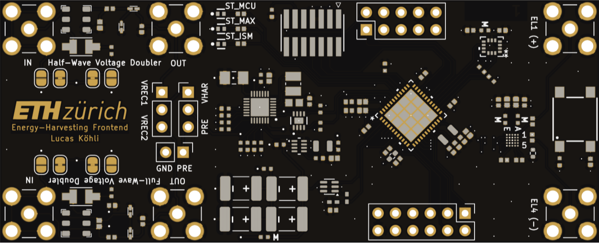
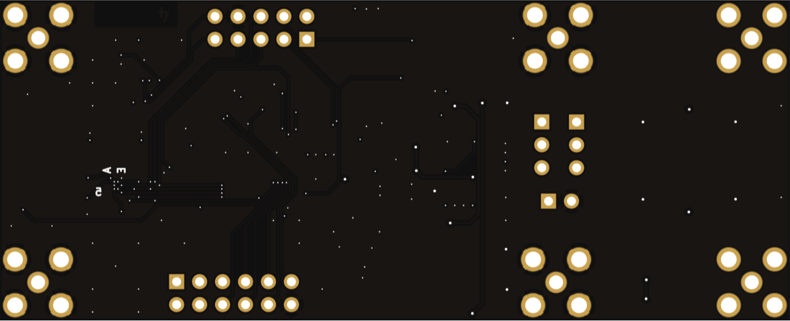
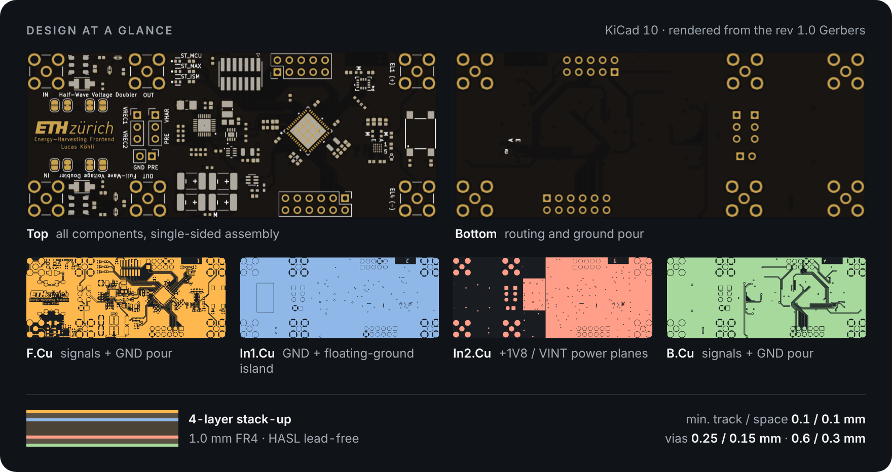

# Hardware

<p align="center">
  
  
</p>

## Board summary

| Parameter | Value |
|---|---|
| Size | 87.5 × 35.6 mm |
| Layers | 4. F.Cu signals + GND · In1 GND plane + floating-ground island · In2 +1V8 / VINT · B.Cu signals + GND |
| Thickness / finish | 1.0 mm FR4 · HASL lead-free |
| Min. track / space | 0.1 / 0.1 mm |
| Vias | 0.25 / 0.15 mm (fan-out), 0.6 / 0.3 mm |
| Parts | 108 placed (43 BOM lines), single-sided assembly |
| EDA | KiCad 10.0 |

## Revision status

| Revision | State | Files |
|---|---|---|
| **1.0** | Fabricated and characterized. Two hardware errata ([HW-1, HW-2](../docs/errata.md)), both fixable with a bodge wire | `kicad/` (layout), `fabrication/rev1.0/` |
| **1.1** | Errata corrected in the schematic; layout not yet updated | `schematic.pdf` |

## Contents

```
hardware/
├── schematic.pdf             5 sheets: root, MCU, energy management, rectifier, BioZ frontend
├── kicad/
│   ├── BSc_Thesis.kicad_pro
│   ├── BSc_Thesis.kicad_sch   root sheet
│   ├── MCU.kicad_sch  Management.kicad_sch  Rectifier.kicad_sch  BioZ_Frontend.kicad_sch
│   │                          sub-sheets (rev 1.1: errata corrected)
│   ├── BSc_Thesis.kicad_pcb   layout, rev 1.0
│   ├── sym-lib-table / fp-lib-table   project-local libraries
│   └── lib/                   symbols and footprints used on the board
└── fabrication/rev1.0/
    ├── gerbers/               copper, mask, paste, silk, outline, drill, job file
    ├── bom.csv                generated from the rev 1.0 layout
    └── ibom.html              interactive BOM / placement view
```

## Opening the project

Open `kicad/BSc_Thesis.kicad_pro` in KiCad 10. All footprints resolve from `kicad/lib` through the project library tables, so no global library setup is needed. Symbols are embedded in the schematic sheets.

The schematic is rev 1.1 (errata corrected) while the layout is rev 1.0 as fabricated. KiCad therefore reports two net differences between schematic and PCB: the [HW-1 and HW-2](../docs/errata.md) fixes. Don't run *Update PCB from Schematic* unless you are starting the rev 1.1 layout.

Most 3D models are embedded in the board file. The AEM30300 model is referenced by file name; download it from e-peas and place it in `kicad/` to see it in the 3D viewer.

## Ordering

The Gerber set in `fabrication/rev1.0/gerbers` is exactly what was fabricated. Zip the folder and upload it to the fab. The `.gbrjob` file carries the stack-up (4 layers, 1.0 mm) and finish.

Before ordering a new batch, apply the rework from the [errata](../docs/errata.md), or wait for a rev 1.1 layout.

## Design files at a glance

- [Interactive BOM](https://lkoehli.github.io/eqs-energy-harvesting-frontend/hardware/fabrication/rev1.0/ibom.html): component placement, searchable by reference or value.
- [Board configuration](../docs/board-configuration.md): jumpers, headers, ports, strap and current-measurement links.
- [Design notes](../docs/design-notes.md): why each stage looks the way it does.


