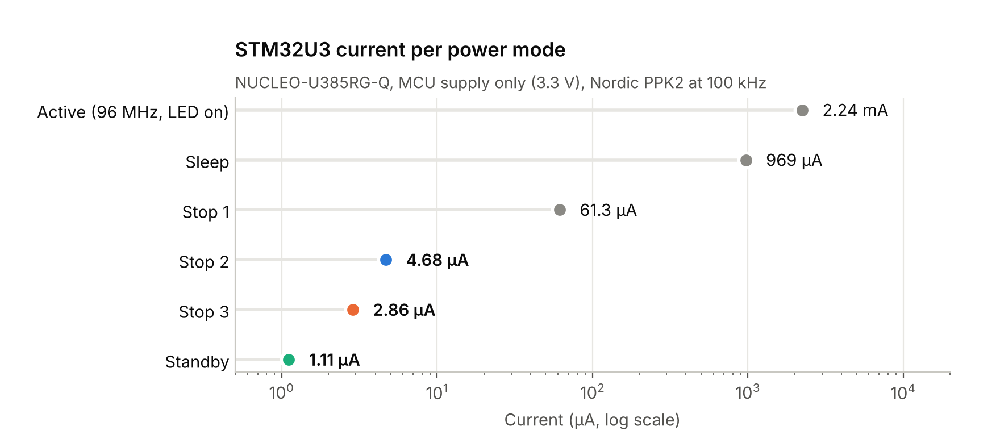
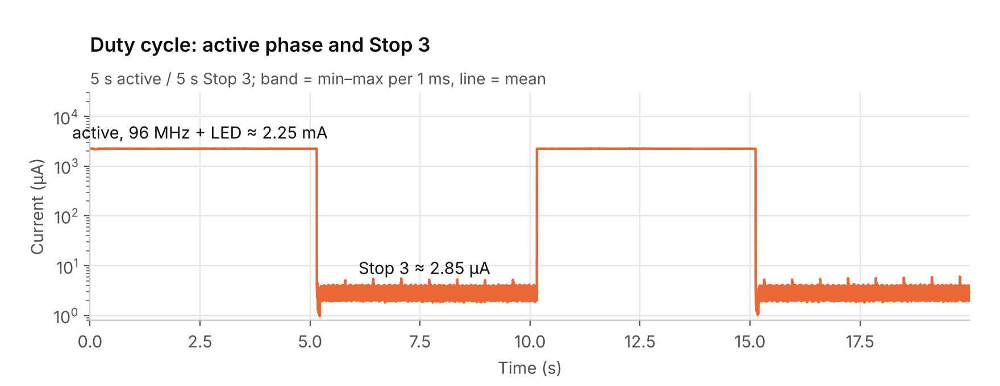
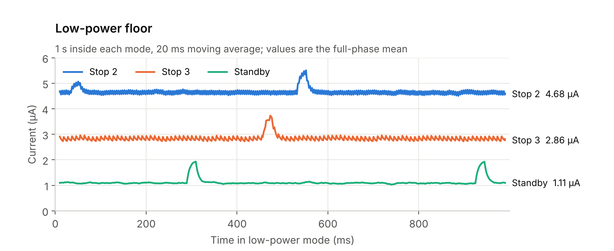
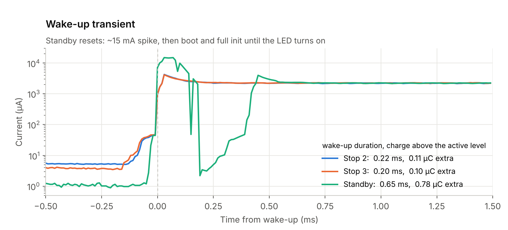
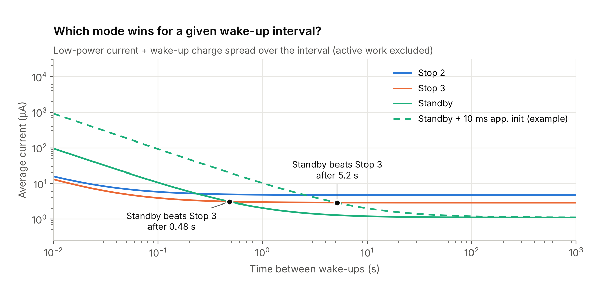

# STM32U3 power-mode measurements

The control domain of the frontend runs entirely on harvested energy, so the microcontroller's low-power floor and the cost of waking up set the energy budget of the whole node. Alongside the board bring-up, the STM32U385's power modes were characterized on a NUCLEO-U385RG-Q board with a Nordic Power Profiler Kit II (PPK2). The [test firmware](firmware) is included.

<p align="center"></p>

## Key results

| Mode | Current | Power at 3.3 V | Wake-up | After wake-up |
|---|---|---|---|---|
| Active (96 MHz, LED on) | 2.24 mA | 7.4 mW | – | – |
| Sleep | 969 µA | 3.2 mW | – | resumes (only the CPU clock was stopped) |
| Stop 1 | 61.3 µA | 202 µW | – | resumes where it stopped |
| Stop 2 | 4.68 µA | 15.4 µW | 0.22 ms, 0.11 µC | resumes where it stopped |
| Stop 3 | **2.86 µA** | **9.4 µW** | 0.20 ms, 0.10 µC | resumes where it stopped |
| Standby | **1.11 µA** | **3.7 µW** | 0.63 ms, 0.95 µC | reset; `main()` starts from the top |

*Current: mean over each low-power phase. Power: current × the Nucleo's 3.3 V MCU supply. On the frontend the MCU runs from 1.8 V, so the power there is lower. Wake-up: time from the first rise until the current settles within ±5 % of the active level, and the charge drawn above that level (mean of all wake-ups recorded).*

- **Three orders of magnitude** separate the active phase (2.24 mA) and Standby (1.11 µA). Stop 3 is the deepest mode in which execution simply resumes, and it draws 39 % less than Stop 2.
- **The active level includes the user LED.** The test firmware switches LD2 on while awake, and LD2 is driven from an MCU pin, so its current flows through JP4. With the LED off, the core at 96 MHz draws about 0.82 mA (see [single-shot recordings](#recordings)).
- **Standby wakes up through a reset.** It shows a ~15 mA spike and needs three times longer than Stop 2/3 until the firmware is back in its loop. That costs about 9× more charge. The measured 0.63 ms already includes the complete restart of the test firmware: boot, clock configuration with the EPOD booster, and GPIO, UART and RTC init.
- **The right mode depends on how often the node wakes up.** With this minimal firmware, Standby beats Stop 3 for sleep intervals longer than about **0.5 s**. A real application re-initializes more after the reset: each extra millisecond at run current moves the break-even by about **0.47 s**.
- **Implication for the node:** use Stop 3 for frequent sampling. Standby pays off for longer idle periods, provided the restart path stays short.

## Measurement setup

| Parameter | Value |
|---|---|
| Board | NUCLEO-U385RG-Q (STM32U385) |
| Instrument | Nordic Power Profiler Kit II (PPK2), 100 kHz sampling, in ampere-meter mode. The Standby firmware notes source-meter mode at 3.3 V; both put 3.3 V on the MCU |
| Measurement point | IDD jumper JP4 removed. PPK2 `VIN` → JP4 pin 1 (3.3 V supply), `VOUT` → JP4 pin 2 (MCU supply input), `GND` → board ground. The ST-LINK is supplied separately and not measured |
| Clock | SYSCLK = MSIS from MSIRC0, 96 MHz, voltage range 1, EPOD booster on, SMPS supply |
| Wake-up | RTC wake-up timer, LSE 32.768 kHz / 16, 10 240 counts = 5 s |
| Firmware | 5 s active (LED on, `HAL_Delay`) → 5 s in the mode under test → repeat. SysTick suspended before entry, entry with `WFI`. See [firmware](#firmware) |

### Recordings

| Recording | Modes | Used for |
|---|---|---|
| 5 s on / 5 s off cycles, firmware in [`firmware/`](firmware) | Stop 2, Stop 3, Standby | All Stop 2 / Stop 3 / Standby values, wake-up analysis |
| Single-shot (one active burst), earlier firmware version | Sleep, Stop 1, Stop 2, Standby | Sleep and Stop 1 values. Cross-check: Stop 2 agrees within 7 % (4.37 µA) |

In the single-shot Standby recording, the CPU runs for 211 ms with the LED still off after waking up, before switching it on. That phase gives the core-only run current of ~0.82 mA at 96 MHz.

## Firmware

The four variants in [`firmware/`](firmware) are the `main.c` files that produced the 5 s-cycle recordings, lightly cleaned up afterwards without changing the measured behaviour (see [firmware/README.md](firmware/README.md#changes-since-the-measurements)). They share the same structure and differ only in how the mode is entered and left:

```c
while (1) {
    HAL_GPIO_WritePin(LED_PORT, LED_PIN, GPIO_PIN_SET);       // LED on: active phase
    HAL_GPIO_WritePin(TRIG_PORT, TRIG_PIN, GPIO_PIN_RESET);   // trigger low = awake
    HAL_Delay(ACTIVE_MS);                                     // 5 s
    Enter_Stop3_5s();   // LED off, SysTick suspended, RTC armed for 5 s, then:
                        // HAL_PWR_EnterSTOPMode(PWR_LOWPOWERMODE_STOP3, PWR_STOPENTRY_WFI);
                        // on wake: SystemClock_Config(); HAL_ResumeTick();
}
```

| Variant | After wake-up | Specific to this mode |
|---|---|---|
| [`main_stop1.c`](firmware/main_stop1.c) | resumes; clock restored to 96 MHz | – |
| [`main_stop2.c`](firmware/main_stop2.c) | resumes; clock restored to 96 MHz | – |
| [`main_stop3.c`](firmware/main_stop3.c) | resumes; clock restored to 96 MHz | RTC routed to wake-up line 7 (`PWR_WAKEUP_SELECT_3`); without it the RTC cannot wake the core from Stop 3 |
| [`main_standby.c`](firmware/main_standby.c) | reset; `main()` from the top | Wake-up line 7 as for Stop 3. The `SBF` flag tells a Standby wake-up from a cold boot, so the boot blink is skipped |

Stop modes are entered with `HAL_PWR_EnterSTOPMode(PWR_LOWPOWERMODE_STOPx, PWR_STOPENTRY_WFI)`, Standby with `HAL_PWR_EnterSTANDBYMode()`.

PA8 is a trigger output for the PPK2's digital input D0, high while asleep. The digital channel was not recorded in these exports, so the analysis aligns on the current edge instead.

## Duty cycle

<p align="center"></p>

A full 20 s recording: the active phase at ~2.25 mA alternates with Stop 3 at ~2.9 µA. The log scale is needed to show both on one axis, nearly three orders of magnitude apart.

## Low-power floor

<p align="center"></p>

One second inside each mode, smoothed with a 20 ms moving average. All three show small periodic bumps of 0.5–1 µA. They are part of the real consumption and are included in the means.

## Wake-up

<p align="center"></p>

Stop 2 and Stop 3 resume execution almost immediately: one short peak of ~4 mA, `SystemClock_Config()`, then the loop runs. Standby wakes up through a reset:
1. A ~15 mA spike.
2. A short drop while the core restarts.
3. The ramp through boot and initialization until the LED is switched on.

The PPK2 samples every 10 µs, so peaks shorter than that are smoothed out. The spike amplitudes are lower bounds.

## Choosing a mode

<p align="center"></p>

For a node that wakes up periodically, the average current outside the active work is

$$\bar I(T) = I_\text{low} + \frac{Q_\text{wake}}{T}$$

where T is the time between wake-ups. Deeper modes lower I_low, but Standby pays a larger Q_wake every time.

- **Measured (solid lines):** the wake-up charge of the test firmware, including its complete restart after Standby. Standby beats Stop 3 above ~0.5 s and Stop 2 above ~0.25 s.
- **Example (dashed line):** an application that needs 10 ms more initialization after the reset, at the ~0.82 mA core run current. Standby then only wins above ~5 s.

Every millisecond of restart work costs about 0.8 µC, so keeping the post-reset path short decides whether Standby is worth it. Measures that help: minimal clock and peripheral setup, and state kept in backup registers.

The active work itself (sensor readout, processing) is the same in every mode and is left out.

## Reproduce

`analyze.py` produces every number and figure in this README from the raw PPK2 exports (CSV, 100 kHz). The recordings (~170 MB) are not part of the repository and are available on request. With the exports in `mcu-power-modes/data/`, run:

```bash
cd mcu-power-modes
python -m pip install numpy pandas matplotlib
python analyze.py                      # writes results/*.csv and figures/*.png
```

| Output | Contents |
|---|---|
| `results/summary.csv` | One current (and power at 3.3 V) per mode, as in the table above |
| `results/levels.csv` | Low-power and active level of every recording |
| `results/wakeups.csv` | Peak, duration and excess charge of every wake-up |
| `results/break_even.csv` | Standby break-even interval vs Stop 2 / Stop 3, and its shift per ms of extra init |
| `results/led_off_phase.csv` | Duration and current of the LED-off running phase in the single-shot Standby recording |

**Method notes:**
- Low-power and active phases are separated with a 1 mA threshold (1.5 mA for Sleep), and crossings are debounced by 5 ms.
- The first 50 ms of each low-power phase and the first 10 ms of each active phase are excluded from the levels, so transitions don't bias them.
